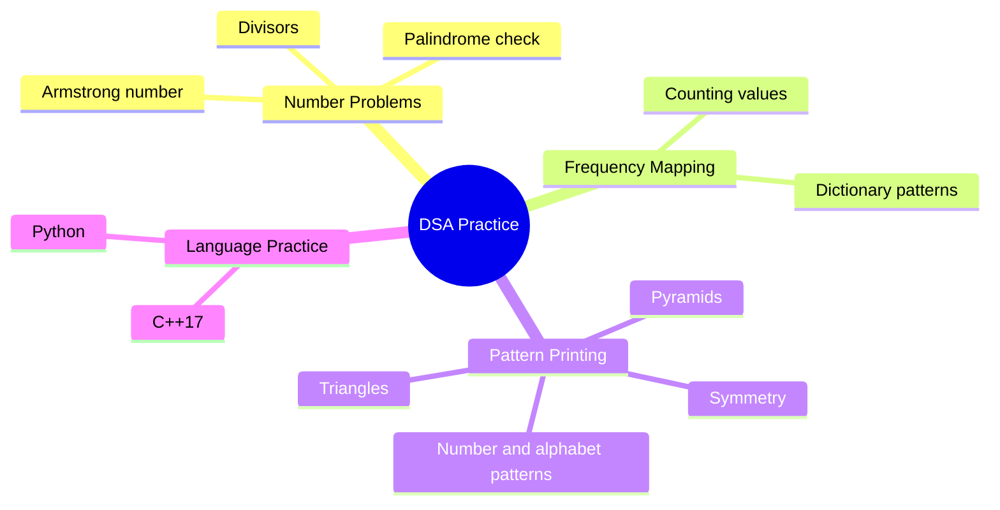

<div align="center">

# DSA Practice Lab

### A hands-on journey through Data Structures & Algorithms

Solve. Understand. Improve. Repeat.

[](https://github.com/rishabhdarji/DSA/actions/workflows/ci.yml)
[](https://www.python.org/)
[](https://isocpp.org/)
[](#license)

</div>

> This repository is my personal DSA practice session: a growing collection of
> small, focused programs written while learning problem-solving fundamentals.

## What is inside?



## Repository map

| File | Focus | How it runs |
| --- | --- | --- |
| [`armstrong.py`](armstrong.py) | Palindrome, Armstrong-number, and divisor practice | Interactive |
| [`basicmath.py`](basicmath.py) | Efficient divisor enumeration using square-root bounds | Interactive |
| [`compare.py`](compare.py) | Frequency counting with a dictionary | Interactive |
| [`freq_map.py`](freq_map.py) | Basic frequency-map implementation | Direct |
| [`pattern.py`](pattern.py) | Number, alphabet, triangle, pyramid, and symmetry patterns | Direct |
| [`LearnC++.cpp`](LearnC++.cpp) | C++17 fundamentals and variable practice | Compile |

## Learning roadmap

```mermaid
flowchart LR
    A["Basic math"] --> B["Arrays & strings"]
    B --> C["Hashing & frequency maps"]
    C --> D["Sorting & searching"]
    D --> E["Recursion"]
    E --> F["Linked lists"]
    F --> G["Stacks & queues"]
    G --> H["Trees & graphs"]
    H --> I["Dynamic programming"]

    classDef active fill:#238636,stroke:#2ea043,color:#fff
    classDef next fill:#30363d,stroke:#8b949e,color:#fff
    class A,C active
    class B,D,E,F,G,H,I next
```



The green topics represent the current practice area. The roadmap will expand
as new solutions are added.

## Run locally

### Python

```powershell
python .\pattern.py
python .\freq_map.py

# Interactive examples
python .\armstrong.py
python .\basicmath.py
python .\compare.py
```

### C++

```powershell
g++ -std=c++17 -Wall -Wextra -pedantic .\LearnC++.cpp -o .\LearnC++.exe
.\LearnC++.exe
```

## Practice principles

- Prefer understanding the approach over memorizing the solution.
- Record time and space complexity for every problem.
- Start with a straightforward solution, then improve it.
- Keep examples small, readable, and easy to revisit.
- Add tests or examples when a solution becomes stable.

## Continuous integration

Every push to `main` and every pull request runs
[`.github/workflows/ci.yml`](.github/workflows/ci.yml), which:

- compiles the Python files on Python 3.10, 3.11, 3.12, and 3.13;
- smoke-tests the current Python programs with sample input; and
- compiles the C++ source with C++17 and common warnings enabled.

## Contributing to the practice session

This is primarily a personal learning repository, but constructive suggestions
are welcome. A useful contribution should include:

1. a clear problem statement;
2. an understandable solution;
3. time and space complexity;
4. sample input and output where applicable; and
5. code that passes the CI workflow.

## License

This is a personal educational project. The code is shared for learning and
reference; individual solutions may be revised as my understanding improves.

<div align="center">

**Keep practicing. Small steps become strong problem-solving skills.**

</div>
